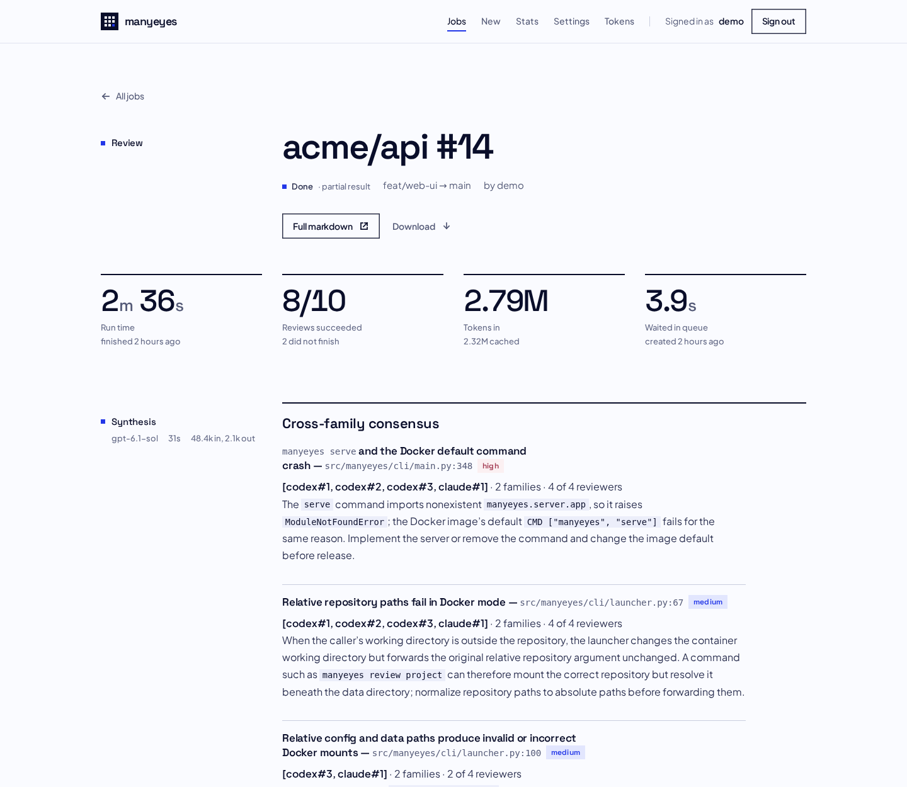
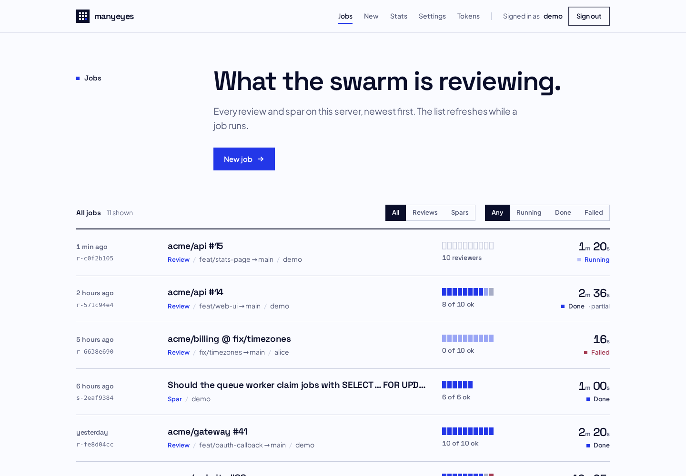
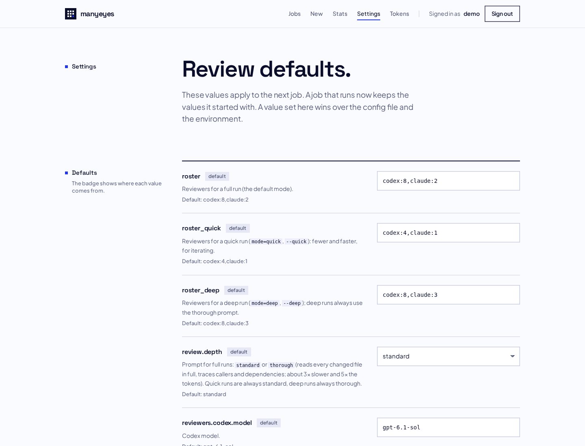
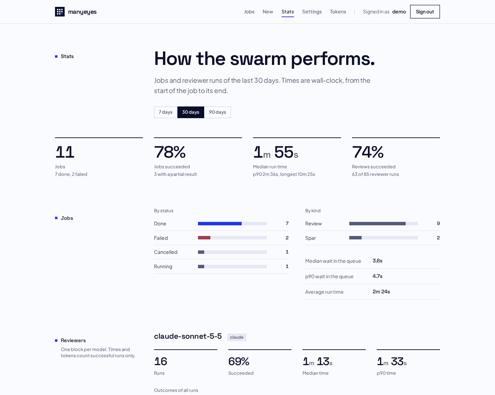
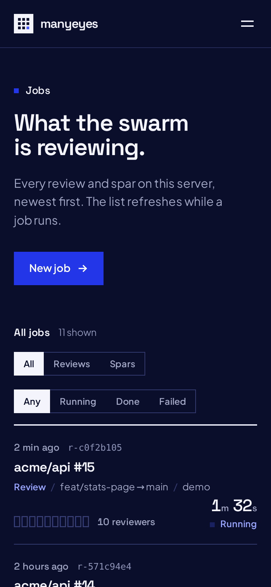

# manyeyes

> "Given enough eyeballs, all bugs are shallow." — Linus's law

**manyeyes runs a swarm of independent AI code reviewers on your change, then merges their findings into one list, ranked by how many reviewers found each problem.**

Ten reviewers that each read the code alone find more than one reviewer that reads it ten times. Where several of them flag the same line on their own, the finding is usually real. manyeyes runs Codex reviewers by default (Claude is optional), each one in its own sandbox, and gives you the merged synthesis in minutes.



There are two ways to use it. Both run the same engine.

| | **CLI** — no server, no MCP | **Server** — self-hosted |
|---|---|---|
| For | You, in any git repository; scripts; coding agents with a shell | A team; coding agents over MCP; a browser |
| Start | `manyeyes review` | `manyeyes serve` (Docker) |
| Results | Printed to stdout, saved under `~/.manyeyes/results/` | Returned to the MCP caller, shown in the web UI |

---

## Use it from the command line

The CLI needs nothing but Docker and your reviewer logins. Run it in a repository, wait a few minutes, read the synthesis.

### Install

```bash
uv tool install git+https://github.com/Masboes/manyeyes@v1.2.0   # or: pipx install git+...
```

The CLI is small. The reviewers (Codex, Claude Code) and the sandbox ship in the manyeyes Docker image, which the CLI pulls on first use. (A PyPI package comes later.)

**Let a coding agent do it.** Tell Claude Code (or any agent with a shell): *"Install manyeyes for me: follow docs/install-for-agents.md in github.com/Masboes/manyeyes."* It does every step and stops only for the logins, which need you.

### Log the reviewers in (once)

```bash
manyeyes login codex            # ChatGPT device login: open the URL, sign in, enter the code
manyeyes login claude           # optional: type /login, pick your Claude account, then /exit
```

The logins live in `~/.manyeyes/auth/`. Every run mounts that folder, so you log in once on your machine. Codex uses your ChatGPT login only, never an API key.

The default rosters include Claude. Without a Claude login, use Codex only: `export MANYEYES_ROSTER=codex:10 MANYEYES_ROSTER_QUICK=codex:5 MANYEYES_ROSTER_DEEP=codex:10` (a server sets the rosters in Settings).

For the synthesis step, add an OpenAI API key (optional; without it you get every review, but no merged list):

```bash
echo 'MANYEYES_SYNTH_OPENAI_API_KEY=sk-...' >> ~/.manyeyes/secrets.env && chmod 600 ~/.manyeyes/secrets.env
```

The key is used for the synthesis only. Reviewers never receive it.

Check everything:

```bash
manyeyes doctor --probe
```

### Review

```bash
cd your-repo
manyeyes review                                  # this branch against origin/HEAD (or main)
manyeyes review --base develop                   # against another base
manyeyes review --roster codex:4                 # fewer reviewers: faster, cheaper
manyeyes review --roster codex:8,claude:2        # mix in Claude
manyeyes review --focus "check the migration for data loss"
manyeyes review --repo owner/name --pr 123       # clone and review a GitHub pull request
```

Ask the swarm a free-form question instead:

```bash
manyeyes spar "Redis or in-process cache for the session store? Argue both sides."
manyeyes spar --roster codex:3 "Is this retry loop idempotent?"
```

Progress goes to stderr, the synthesis to stdout:

```
$ manyeyes review --roster codex:3,claude:1
manyeyes: job r-d0daffaa: your-repo — 4 reviewers (codex:3,claude:1)
manyeyes: 4 reviewers started; quorum 4
manyeyes: [1/4] codex#2    ok               2m27s
manyeyes: [2/4] codex#3    ok               2m27s
manyeyes: [3/4] codex#1    ok               2m55s
manyeyes: [4/4] claude#1   ok               3m58s
manyeyes: synthesis…
manyeyes: synthesis done in 41.8s
# Review: your-repo

**Reviews:** 4 of 4 succeeded

## Synthesis

## Cross-family consensus

### Relative repository paths fail in Docker mode — `src/cli/launcher.py:67` — medium
**[codex#1, codex#2, codex#3, claude#1]** · 2 families · 4 of 4 reviewers
When the caller's working directory is outside the repository, …
…
manyeyes: full result: /home/you/.manyeyes/results/r-d0daffaa.md
```

| Option | Effect |
|---|---|
| `--full` | Print every review after the synthesis |
| `--json` | Print the result as JSON: status, outcome counts, synthesis, every review with its tokens and timing |
| `--no-synth` | Skip the synthesis |
| `--roster` | Reviewers for this run, for example `codex:10` or `codex:8,claude:2` |
| `--quick` | Quick mode: fewer reviewers, about a minute — while you iterate |
| `--deep` | Deep mode: thorough prompt, 3–5 minutes, about 5× the tokens — for risky changes |
| `--context owner/name` | A related repo the reviewers get read-only, to catch breakage across repos (repeat, at most 5) |
| `manyeyes jobs` | List past runs; `manyeyes jobs show <id>` prints one again |
| `manyeyes usage` | How much of the Codex and Claude plans is used, and when each window resets (spends no tokens) |
| `manyeyes version --check` | Show the version and whether a newer release is out |

Exit codes: `0` at least one review came back, `1` the run failed, `2` every reviewer was rate-limited, `130` interrupted.

### What the reviewers see

The reviewers get a clean copy of your change: the tracked files at HEAD, plus your uncommitted changes and untracked files (up to 1 MB each). Ignored files, such as `.env`, never reach a reviewer. Each reviewer runs in a bubblewrap jail that shows it only that copy and its own login — not your home folder, not your other secrets.

### From a coding agent, without MCP

Any agent with a shell can call the CLI directly. Add this to the agent's instructions (for example your `CLAUDE.md`):

```markdown
## Code review
Before you open a PR, run `manyeyes review --json` in the repository (it takes 3 to 15
minutes; run it in the background). Read `synthesis` from the JSON output. Fix every
finding that several reviewers agree on; judge single-reviewer findings on their merits.
```

`--json` keeps the output easy to parse, and the exit code tells the agent whether the run worked.

---

## Run it as a server

The server gives a team one place to run reviews: an MCP endpoint for coding agents, a REST API, and a web UI where you watch jobs, read reviews, change the default line-up and see stats.

| Jobs | Settings | Stats |
|---|---|---|
|  |  |  |

Connect Claude Code (it signs you in with GitHub on the first call):

```bash
claude mcp add --transport http manyeyes https://your-host/manyeyes/mcp
```

The agent then sees `swarm_review`, `swarm_spar`, `swarm_get`, `swarm_ls` and a few more. `swarm_review` blocks until the review is done and returns the synthesis, so the agent can act on it in the same turn. For a change that other repositories depend on, pass `context_repos` (for example `["acme/web", "acme/events@main"]`): the reviewers get those repos read-only and check whether the change breaks a caller, a shared contract or an event shape there. The server keeps a cached clone of each, so after the first use a context repo adds seconds, not minutes.

Three modes: `"full"` (default, the normal review, 1–2 minutes), `"quick"` (fewer reviewers, about a minute, while iterating) and `"deep"` (a thorough prompt that reads every changed file and traces dependencies, 3–5 minutes and about 5× the tokens — for risky changes only).

Self-hosting takes a data directory, a GitHub OAuth App and one container: see the [self-hosting guide](docs/self-hosting.md).



---

## Defaults

| Setting | Default |
|---|---|
| Reviewers, full mode (default) | `codex:8,claude:2`, standard prompt — about 1–2 minutes |
| Reviewers, quick mode | `codex:4,claude:1`, standard prompt — about a minute |
| Reviewers, deep mode | `codex:8,claude:3`, thorough prompt — 3–5 minutes, about 5× the tokens |
| Codex model, effort | `gpt-6.1-sol`, `medium` |
| Claude model, effort | `sonnet` (Claude Code's newest Sonnet), `high` |
| Per-reviewer time limit | 10 minutes |
| Straggler rule | when 80 % of reviewers have succeeded, the rest get 2 more minutes |
| Synthesis model | `gpt-6.1-sol` |

Change any of them per run (`--roster`, `--set key=value`), in `~/.manyeyes/config.toml`, with environment variables, or — on a server — on the Settings page. See the [configuration reference](docs/configuration.md).

## How it works

```
your change ──► clean copy ──► reviewer 1 ─┐
                               reviewer 2 ─┤   each in its own jail,
                                  …        ├─► each reads the code alone ──► synthesis ──► you
                               reviewer N ─┘   (Codex, Claude)                (OpenAI API)
```

Every reviewer run is recorded: model, effort, duration, input/cached/output/reasoning tokens, and its outcome (`success`, `timeout`, `straggler_killed`, `rate_limited`, `auth_failed`, `error`, `cancelled`) with a one-line reason.

## Documentation

- [Quickstart](docs/quickstart.md) — local install, first review
- [Install guide for coding agents](docs/install-for-agents.md) — exact steps, checks, and what needs a human
- [Self-hosting](docs/self-hosting.md) — server, GitHub sign-in, reverse proxy, MCP clients, trust model
- [Configuration reference](docs/configuration.md) — every setting
- [Architecture](docs/architecture.md) and [design](docs/design.md)
- [Releasing](docs/releasing.md) — versions, releases, how updates reach users
- [Changelog](CHANGELOG.md)

## Status

`1.2.0` — stable.

## License

[Apache License 2.0](LICENSE).
